# AZR PRINT'S — System Documentation

Campus printing portal for Zamboanga Peninsula Polytechnic State University (ZPPSU). This file is the single reference for diagrams, requirements, terms, and technology.

**FigJam board (all generated diagrams):** [AZR PRINT'S diagrams](https://www.figma.com/board/IEXmm6cdJ39YEseiWrXmDI)

| # | Diagram | Type | FigJam |
|---|---------|------|--------|
| 1 | System architecture | Architecture flowchart | On board |
| 2 | Student order and payment | Flowchart | On board |
| 3 | Support ticket chat | Flowchart | On board |
| 4 | Auth and role guard | Flowchart | On board |
| 5 | Use case overview | Flowchart (use-case substitute) | On board |
| 6 | Entity-relationship model | ERD | On board |
| 7 | Order + PayMongo | Sequence (UML) | On board |
| 8 | Ticket live chat | Sequence (UML) | On board |
| 9 | Order status | State (UML) | On board |
| 10 | Ticket status | State (UML) | On board |
| 11 | Print job status | State (UML) | On board |

FigJam `generate_diagram` does not support UML use-case ovals or class diagrams. Those appear below as Mermaid so they still render in GitHub/Markdown.

---

## 1. Purpose

AZR PRINT'S lets students upload print files, get a peso quote, pay through PayMongo (InstaPay QR Ph, GCash, Maya, card), and track the job. Admins manage orders, files, users, pricing, printer settings, notifications, and a live support inbox.

---

## 2. Technology stack

### 2.1 Runtime and app

| Layer | Technology | Role in this project |
|-------|------------|----------------------|
| Language | TypeScript 5 | App, API routes, types |
| UI library | React 19 | Client pages and shared components |
| Framework | Next.js 16.2 (App Router) | Pages, Route Handlers, middleware |
| Styling | Tailwind CSS 4 | `--pp-*` tokens, no extra UI kit |
| Hosting | Vercel | Production deploy of the Next.js app |
| Local server | Node.js 20+ (XAMPP used only as a local folder host) | `npm run dev` |

### 2.2 Backend and data

| Layer | Technology | Role in this project |
|-------|------------|----------------------|
| Auth | Supabase Auth | Email/password, recovery, session cookies |
| Database | PostgreSQL (Supabase) | `profiles`, `orders`, `tickets`, RLS |
| Storage | Supabase Storage | Private bucket `order-files` (10 MB) |
| Realtime | Supabase Realtime | `postgres_changes` on `ticket_messages` |
| Client SDK | `@supabase/ssr`, `@supabase/supabase-js` | Browser + server clients |
| Payments | PayMongo | Checkout Session / Payment Link + webhook |
| Print shop | Node print worker (`print-worker/`) | Claims `print_jobs`, downloads files, prints |

### 2.3 File analysis (client)

| Library | Use |
|---------|-----|
| `pdfjs-dist` | PDF page / image detection |
| `jszip` | DOCX unzip + page estimate |

### 2.4 Environment variables

| Variable | Where it is used |
|----------|------------------|
| `NEXT_PUBLIC_SUPABASE_URL` | Browser + server Supabase |
| `NEXT_PUBLIC_SUPABASE_ANON_KEY` | Browser + server (RLS-enforced) |
| `SUPABASE_SERVICE_ROLE_KEY` | Server-only Auth admin (users CRUD) |
| `PAYMONGO_SECRET_KEY` | Checkout + webhook verification |
| `NEXT_PUBLIC_PAYMONGO_PUBLIC_KEY` | Client PayMongo config if needed |
| `PAYMONGO_WEBHOOK_SECRET` | Webhook signature |
| `NEXT_PUBLIC_APP_URL` | Redirects and checkout return URL |

---

## 3. Functional requirements

| ID | Requirement | Actor | Implementation |
|----|-------------|-------|----------------|
| FR-01 | Register with name, student ID, college, phone | Student | `/signup`, `handle_new_user` profile trigger |
| FR-02 | Log in, log out, reset password | Both | `/login`, `/forgot-password`, `/reset-password` |
| FR-03 | Role-gated routes (`/user/*` vs `/admin/*`) | System | `src/lib/supabase/middleware.ts` |
| FR-04 | Upload PDF, DOCX, or image (max 10 MB) | Student | `POST /api/orders` + `order-files` |
| FR-05 | Auto-detect pages and mixed text/photo content | Student | `src/lib/content-analysis.ts` |
| FR-06 | Quote in PHP from admin pricing (document B&W/color, photo) | Student | `src/lib/pricing.ts` |
| FR-07 | Pay via PayMongo (InstaPay, GCash, Maya, card) | Student | `POST /api/orders/checkout` |
| FR-08 | Confirm payment after redirect | Student | `POST /api/orders/confirm-payment` |
| FR-09 | Mark paid via webhook | System | `POST /api/paymongo/webhook` |
| FR-10 | List own orders with status and payment badges | Student | `/user/orders` |
| FR-11 | View, download, replace, delete order file | Owner or admin | `GET/PUT/DELETE /api/orders/[id]/file` |
| FR-12 | Open a support ticket (subject, category, first message) | Student | `POST /api/tickets` |
| FR-13 | Chat on a ticket until resolved | Student, admin | `POST /api/tickets/[id]/messages` + Realtime |
| FR-14 | Reopen a closed ticket when the student messages | System | Messages API sets `status = open` |
| FR-15 | Inbox of all tickets with live thread + status/category | Admin | `/admin/tickets`, `PATCH /api/admin/tickets/[id]` |
| FR-16 | Manage all orders and job status | Admin | `/admin/orders`, `PATCH /api/admin/orders/[id]` |
| FR-17 | CRUD users (create, edit role/profile, delete) | Admin | `/api/admin/users` |
| FR-18 | Update pricing rates | Admin | `PUT /api/admin/pricing` |
| FR-19 | Broadcast notifications | Admin | `POST /api/admin/notifications` |
| FR-20 | Configure shop hours/name and printer settings | Admin | `/api/admin/settings`, `/api/admin/printer` |
| FR-21 | Queue and claim print jobs on the shop PC | Print worker | `print_jobs` + `claim_next_print_job` |

---

## 4. Non-functional requirements

| ID | Category | Requirement |
|----|----------|-------------|
| NFR-01 | Security | RLS on all public tables; `is_admin()` for admin rows |
| NFR-02 | Security | Service role key never exposed to the browser |
| NFR-03 | Security | Storage bucket `order-files` is private; signed URLs expire (~10 min) |
| NFR-04 | Security | Students cannot open another student's ticket URL (server redirect + RLS) |
| NFR-05 | Security | Sender role on messages is set server-side from the real profile, not the client |
| NFR-06 | Performance | Client-side list queries (orders, tickets, files) with indexes on `user_id`, `updated_at` |
| NFR-07 | Availability | Hosted on Vercel; database on Supabase; print worker is shop-local |
| NFR-08 | Usability | Same Tailwind / `--pp-*` language; no extra UI library |
| NFR-09 | Usability | Chat updates without refresh (Realtime INSERT on `ticket_messages`) |
| NFR-10 | Integrity | Check-constraint enums for order, payment, ticket, and print-job status |
| NFR-11 | Integrity | Failed order insert rolls back the uploaded storage object |
| NFR-12 | Limits | Upload cap 10 MB; allowed MIME: PDF, DOC, DOCX, JPEG, PNG, WEBP, GIF |
| NFR-13 | Localization | Currency display in Philippine peso (`formatPHP`) |
| NFR-14 | Maintainability | Migrations in `supabase/migrations/` (`001`–`003`) |
| NFR-15 | Observability | PayMongo webhook verifies signature when secret is set |
| NFR-16 | Compatibility | Desktop-first admin tables; student flows usable on phone (responsive cards) |

---

## 5. Terms and definitions

| Term | Definition |
|------|------------|
| **AZR PRINT'S** | The ZPPSU campus printing portal (this system). |
| **Student / user** | Authenticated account with `profiles.role = 'user'`. |
| **Admin** | Authenticated account with `profiles.role = 'admin'`. |
| **Profile** | Row in `public.profiles` (1:1 with `auth.users`). Email lives in Auth, not profiles. |
| **Order** | A print request (`ORD-{timestamp}`) with file, pages, copies, amount, job status, payment status. |
| **Order file** | Object in Storage bucket `order-files` at `{userId}/{orderId}-{safeName}`. |
| **Print type** | `document` or `photo` (large format removed from the UI). |
| **Payment status** | `pending`, `paid`, or `failed`. |
| **Job status** | Order workflow: `pending`, `in_progress`, `completed`, `cancelled`. |
| **Print job** | Shop-queue row for the local worker: `queued`, `printing`, `completed`, `failed`, `cancelled`. |
| **Ticket** | Support case: subject, category, status. |
| **Ticket category** | `order_issue`, `payment`, `printer`, `report`, `general`. |
| **Ticket status** | `open`, `in_progress`, `resolved`, `closed`. |
| **Ticket message** | Chat line with `sender_role` `user` or `admin`. |
| **RLS** | Row Level Security — Postgres policies that hide other users' rows. |
| **Realtime** | Supabase channel that pushes new `ticket_messages` rows to open threads. |
| **PayMongo** | Philippine payment gateway used for hosted checkout. |
| **InstaPay / QR Ph** | Bank QR payment method offered on PayMongo checkout. |
| **Signed URL** | Time-limited Storage link used for view/download. |
| **Print worker** | Local Node process that claims jobs and sends files to the shop printer. |
| **AppShell** | Shared sidebar/header for admin and student portals. |

---

## 6. Actors and use cases

Actors: **Student**, **Admin**, **PayMongo**, **Print Worker**, **System**.

### 6.1 Use case diagram (Mermaid)

FigJam cannot render classic UML use-case ovals; this is the documentation form. A grouped flowchart version is also on the FigJam board.

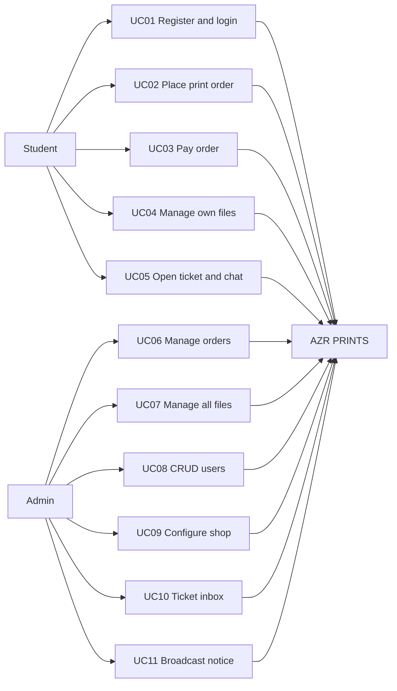

### 6.2 Use case catalog

| ID | Name | Actor | Main flow |
|----|------|-------|-----------|
| UC01 | Register / login | Student, Admin | Sign up or log in; middleware sends admin vs student home |
| UC02 | Place print order | Student | Upload → analyze → quote → `POST /api/orders` |
| UC03 | Pay order | Student, PayMongo | Checkout session → pay → webhook/confirm |
| UC04 | Manage own files | Student | View / download / replace / delete on My Orders |
| UC05 | Support chat | Student | Create ticket → thread → Realtime messages |
| UC06 | Manage orders | Admin | Table + status dropdown |
| UC07 | Manage files | Admin | `/admin/files` preview + CRUD |
| UC08 | CRUD users | Admin | Create, edit, delete via Auth admin API |
| UC09 | Configure shop | Admin | Pricing, hours, printer settings |
| UC10 | Ticket inbox | Admin | Split inbox + reply + status/category |
| UC11 | Notifications | Admin | Broadcast row with `user_id` null |

---

## 7. UML class diagram (logical)

Not generated in FigJam (unsupported type). Logical model of the domain:

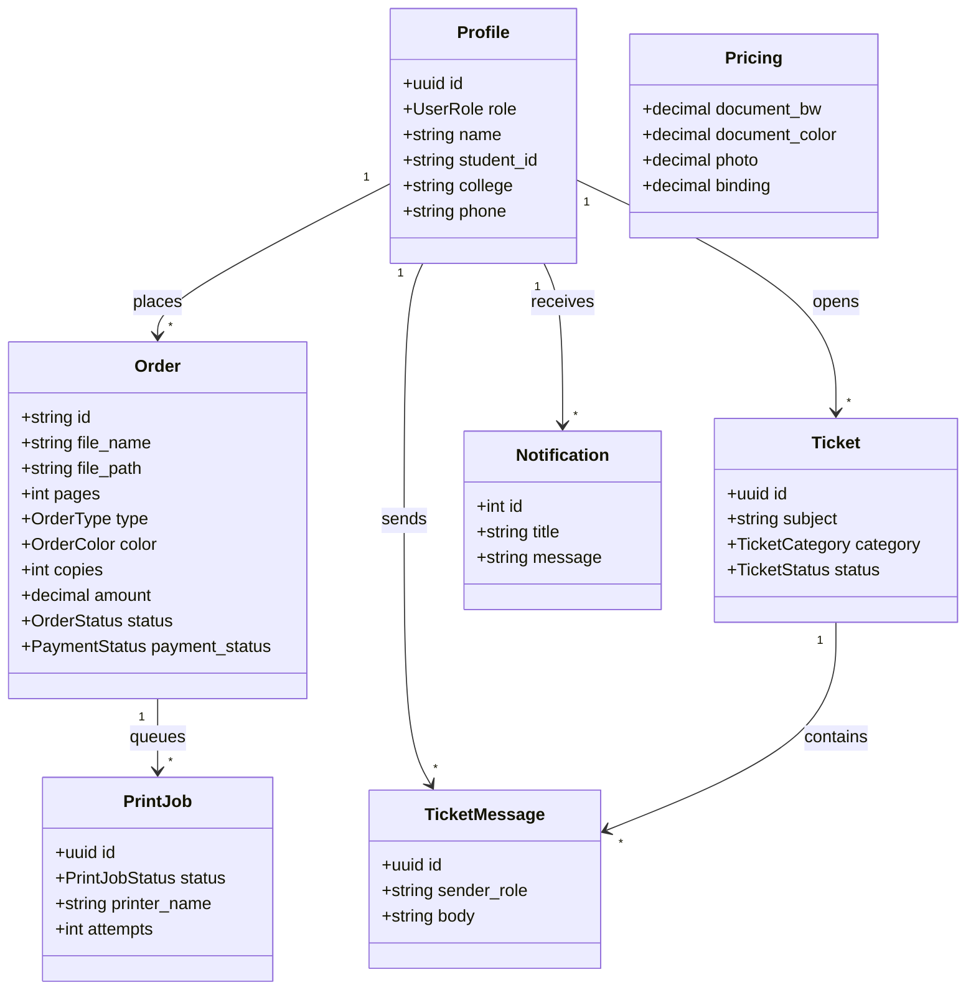

---

## 8. System architecture

See FigJam: **AZR PRINT'S System Architecture**.

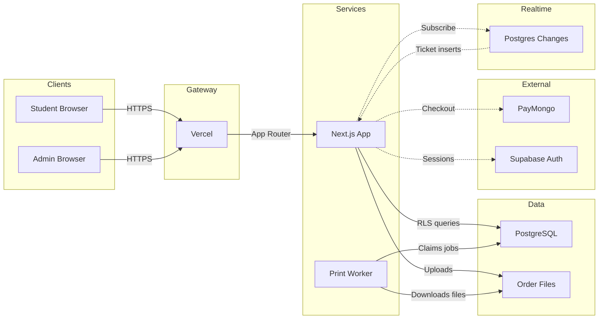

---

## 9. Process flowcharts

### 9.1 Student order and payment

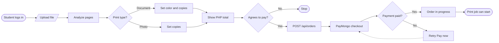

### 9.2 Support ticket chat

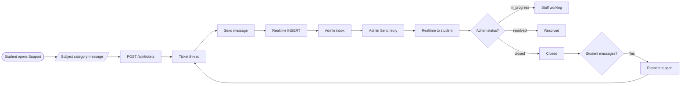

### 9.3 Auth and role guard

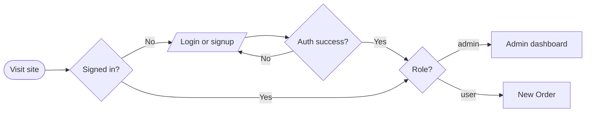

---

## 10. Entity-relationship diagram

Source of truth: `supabase/migrations/001_initial.sql`, `002_print_queue.sql`, `003_tickets.sql`.

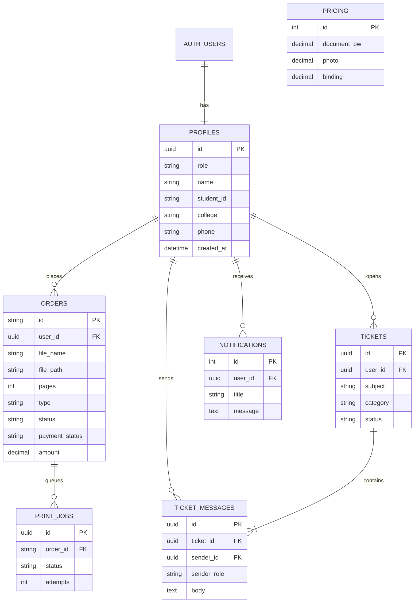

Singletons (no FK to users): `pricing`, `shop_settings`, `printer_settings` — one row (`id = 1`).

---

## 11. Sequence diagrams (UML)

### 11.1 Order create and PayMongo checkout

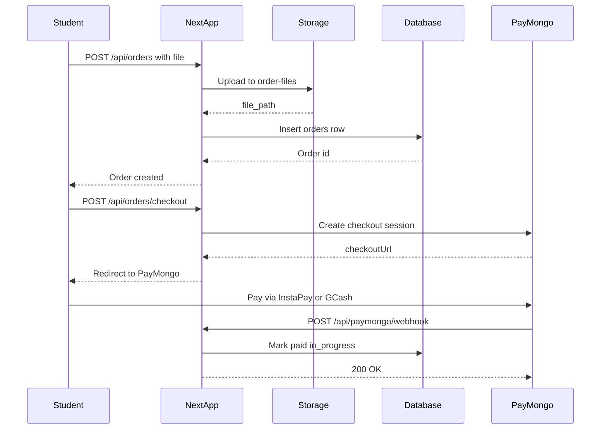

### 11.2 Ticket live chat

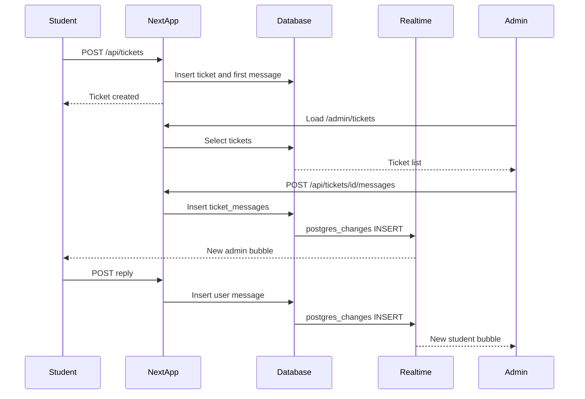

---

## 12. State diagrams (UML)

### 12.1 Order status

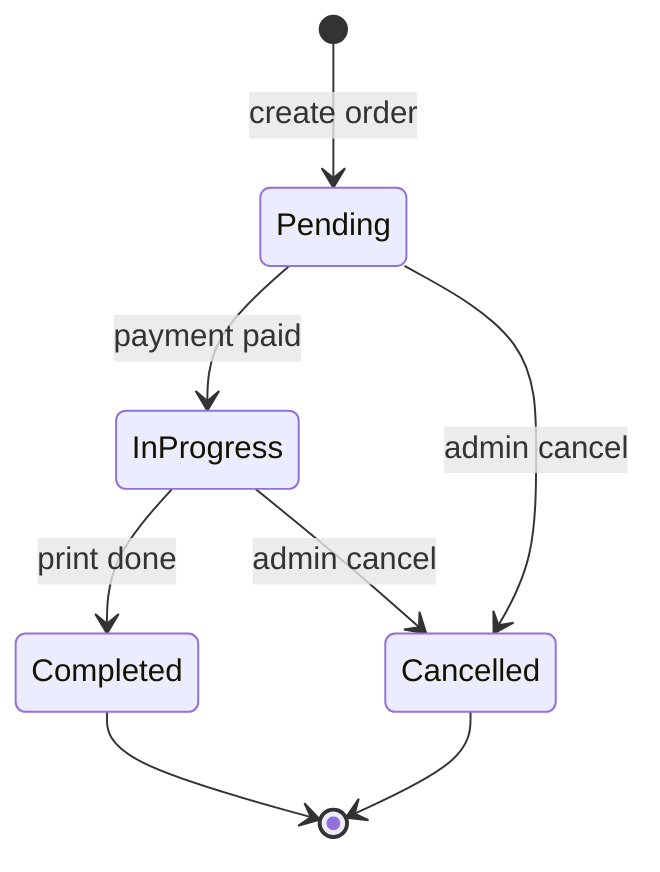

### 12.2 Payment status

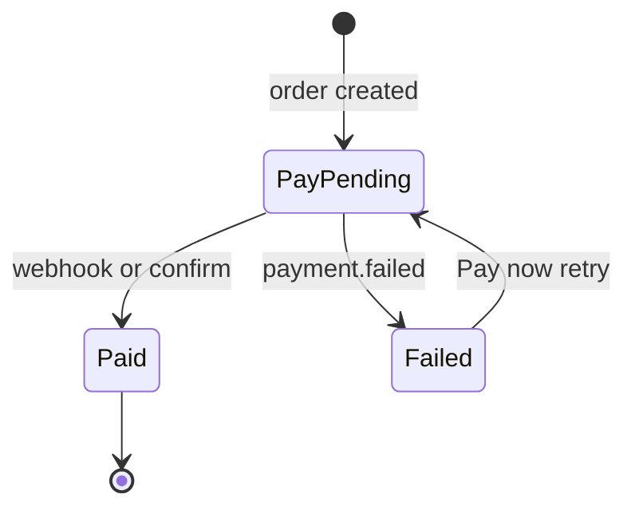

### 12.3 Ticket status

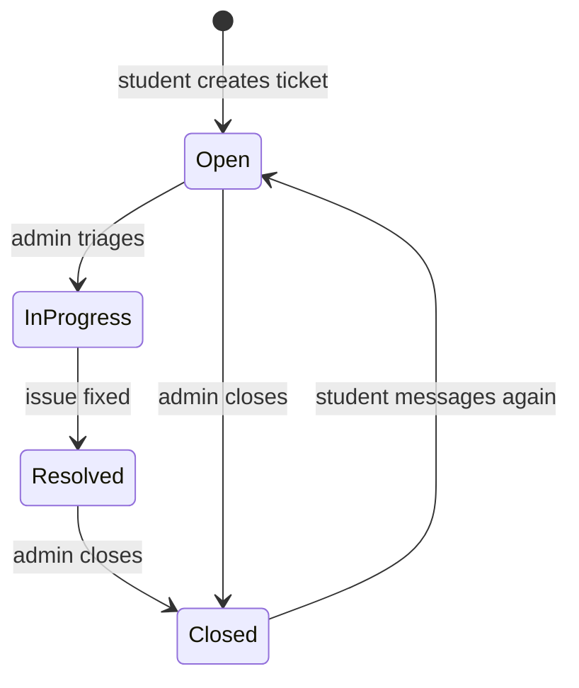

### 12.4 Print job status

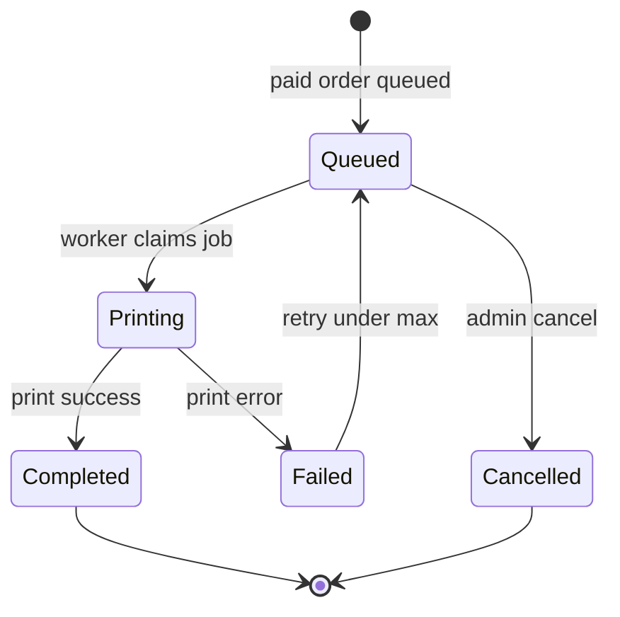

---

## 13. Module map (code)

| Area | Paths |
|------|--------|
| Student UI | `src/app/user/dashboard`, `orders`, `tickets`, `profile` |
| Admin UI | `src/app/admin/dashboard`, `orders`, `files`, `tickets`, `users`, `pricing`, `printer`, `notifications`, `settings` |
| Shared UI | `src/components/AppShell.tsx`, `TicketThread.tsx`, `OrderFileActions.tsx` |
| Order API | `src/app/api/orders/**` |
| Ticket API | `src/app/api/tickets/**`, `src/app/api/admin/tickets/**` |
| Admin API | `src/app/api/admin/**` |
| Domain types | `src/lib/types.ts` |
| Pricing | `src/lib/pricing.ts` |
| Auth gate | `src/lib/require-admin.ts`, `src/lib/supabase/middleware.ts` |
| SQL | `supabase/migrations/001_initial.sql`, `002_print_queue.sql`, `003_tickets.sql` |

---

## 14. Out of scope (v1)

- Ticket attachments and read receipts
- Large-format print type in the student UI
- Multi-campus inventory / stock
- In-app card capture (PayMongo hosted checkout only)

---

*Generated from the live AZR PRINT'S codebase (Next.js + Supabase + PayMongo). FigJam file key: `IEXmm6cdJ39YEseiWrXmDI`.*
